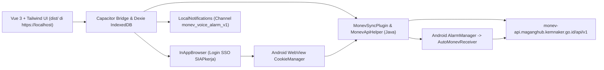

# MagangHub Reminder — Monev Auto-Reminder & Auto-Sync

Aplikasi Android dan Web berbasis **Vue 3 + TypeScript + Tailwind CSS + Dexie.js + Capacitor** yang terhubung langsung dengan portal **`monev.maganghub.kemnaker.go.id`** untuk memantau status kehadiran harian peserta magang, membunyikan pengingat suara kustom, mencatat riwayat kehadiran lengkap, serta mengisi Monev otomatis pada pukul **23:00** (atau jam sesuai pengaturan) jika masih kosong.

---

## Fitur Utama

- **Login Wajib via Portal Resmi (`AuthLoginGate`)**
  - Autentikasi langsung melalui portal SIAPkerja / MagangHub menggunakan **In-App Browser** (`@capacitor/inappbrowser`).
  - Aplikasi **tidak pernah menyimpan username atau password** secara *plaintext*; autentikasi bergantung pada sesi cookie/token resmi Kemnaker.
- **Auto-Sync Status & Profil Peserta**
  - Menyinkronkan nama, foto, instansi/perusahaan, posisi magang, periode magang, hari libur mingguan (`off_days`), dan status kehadiran harian (`/users/me` & `/users/me/home`) setiap aplikasi dibuka/resume maupun sebelum alarm berbunyi.
- **Pengingat Utama, Snooze Eskalasi, & Catch-Up Check**
  - Hitung mundur *real-time* menuju jam pengingat utama (default **17:00 WIB**, dapat diubah beserta zona waktu **WIB / WITA / WIT**).
  - Alarm utama + eskalasi ulang (**17:30** dan **18:00**), otomatis dibatalkan jika portal mendeteksi Monev hari ini sudah terisi atau hari ini libur/izin.
  - **Catch-Up Check** langsung mengecek dan mengingatkan apabila aplikasi baru dibuka melewati jam target.
  - Seluruh label jam dan zona waktu pada UI ikut berubah secara dinamis mengikuti konfigurasi pengguna.
- **Auto-Isi Monev Pukul 23:00 (Foreground & Background)**
  - Jika hingga pukul **23:00** (dapat dikustomisasi di tab **Jadwal & Alarm**) pada hari kerja aktif status Monev masih belum terisi, aplikasi menyalin catatan log harian terakhir yang pernah diisi (`activity_log`, `lesson_learned`, `obstacles`) lalu mengirimkannya ke portal (`POST /api/v1/attendances/with-daily-log`).
  - Di Android, fitur ini dijadwalkan di lapisan OS memakai `AlarmManager` (`AutoMonevReceiver.java`) + `BOOT_COMPLETED` agar tetap berjalan walau aplikasi ditutup atau layar mati.
- **Suara Notifikasi Kustom**
  - Menggunakan audio pengingat khusus (`public/sounds/reminder.mp3` untuk web/WebView dan `res/raw/reminder_sound.mp3` pada channel Android `monev_voice_alarm_v1`).
- **Riwayat Kehadiran Lengkap**
  - Menyusun seluruh kalender dari tanggal mulai magang hingga hari ini berdasarkan gabungan `/attendances`, `/daily-logs`, `/holidays` (nasional, provinsi, kabupaten/kota), serta `off_days`.
  - Mencatat dan memfilter seluruh status: **Hadir** (`PRESENT`), **Izin** (`ON_LEAVE` beserta alasan), **Tidak Hadir** (`ABSENT`), **Libur** (`DAYOFF` / libur Kemnaker / akhir pekan), dan **Belum Diisi** lengkap dengan pratinjau log aktivitas dan penanda `Auto`.
- **Mode Hari Libur & Notifikasi Telegram (Opsional)**
  - Database tanggal merah RI (2025–2027) tersimpan offline, ditambah tombol cepat **Libur Hari Ini** dan opsi pengiriman pesan pengingat ke **Bot Telegram** pengguna saat online.

---

## Arsitektur & Cara Kerja di HP Android

Aplikasi ini dibungkus menjadi APK native memakai **Capacitor 7** sehingga **tidak membutuhkan server backend perantara, tidak perlu laptop menyala, dan tidak bergantung pada Wi-Fi yang sama**:



1. **Aset Frontend Bundled Offline (`webDir: 'dist'`)**
   Hasil build Vue, Tailwind CSS, font (`Inter` & `Plus Jakarta Sans`), ikon `Material Symbols`, logo aplikasi, dan audio `reminder.mp3` disematkan langsung ke dalam APK.
2. **Penanganan Redirect SSO & Cookie Native**
   `scripts/patch-android.mjs` mengonfigurasi `res/xml/network_security_config.xml` untuk mengizinkan alur redirect `http://account.kemnaker.go.id` → `https://monev.maganghub.kemnaker.go.id`, lalu menyimpan sesi autentikasi di `CookieManager`.
3. **Bypass Batasan CORS via Native Java (`MonevSyncPlugin` & `MonevApiHelper`)**
   Request langsung ke API Kemnaker dilakukan dari lapisan native Java menggunakan `CookieManager` + `POST /api/v1/auth/refresh` sehingga aman dari blokir CORS WebView.
4. **Penjadwalan Background OS (`AutoMonevReceiver` & `LocalNotifications`)**
   Notifikasi lokal memakai channel Android berprioritas tinggi dengan audio `res/raw/reminder_sound.mp3`, sedangkan eksekusi auto-isi `23:00` dijalankan oleh `BroadcastReceiver` Android (`AlarmManager`) dan otomatis dijadwalkan ulang setelah perangkat reboot (`BOOT_COMPLETED`).
5. **Mode Pratinjau Browser Laptop (`npm run dev`)**
   Saat dijalankan di browser desktop, `vite.config.ts` menyediakan proxy `/monev-api` untuk pengujian dengan `monev_access_token` sementara.

---

## Tech Stack

| Kategori | Teknologi |
| :--- | :--- |
| **Frontend Framework** | Vue `^3.5.13` (`<script setup lang="ts">`), TypeScript `~5.7.2` |
| **Styling & Aset Offline** | Tailwind CSS `^3.4.17`, `@fontsource/inter`, `@fontsource/plus-jakarta-sans`, `material-symbols` |
| **Penyimpanan Lokal** | Dexie.js `^4.0.11` (IndexedDB) |
| **Mobile Runtime & Plugin** | Capacitor `^7.0.0` (`@capacitor/core`, `@capacitor/android`, `@capacitor/app`, `@capacitor/local-notifications`, `@capacitor/inappbrowser` `^2.2.0`) |
| **Custom Native Android** | Java (`MonevSyncPlugin.java`, `MonevApiHelper.java`, `AutoMonevReceiver.java`), `minSdkVersion = 26` |
| **Build & Testing** | Vite `^6.0.0`, `vue-tsc` `^2.2.0`, Vitest `^3.0.5` |
| **CI/CD APK** | GitHub Actions (`ubuntu-latest`, Node `22`, Java `21` Temurin, `./gradlew assembleDebug`) |

---

## Struktur Direktori

```text
.
├── .github/workflows/
│   └── build-android.yml        # Pipeline CI build app-debug.apk otomatis
├── public/
│   ├── app-logo.png             # Favicon & logo header/login web
│   └── sounds/reminder.mp3      # Audio pengingat web/WebView
├── resources/android/
│   ├── mipmap-*/                # Ikon launcher Android (mdpi..xxxhdpi)
│   ├── raw/reminder_sound.mp3   # Audio notifikasi native Android
│   └── splash_logo.png          # Logo splash screen Android
├── scripts/
│   └── patch-android.mjs        # Patch manifest, permissions, Java plugin, audio & ikon
├── src/
│   ├── assets/main.css          # Import font offline, ikon, & layer Tailwind
│   ├── components/
│   │   ├── auth/                # AuthLoginGate.vue
│   │   ├── history/             # HistoryTabView.vue
│   │   ├── home/                # HomeTabView, HeroCountdownCard, ProfileBanner, SmartAlarmsCard, dll.
│   │   ├── layout/              # AppHeader.vue, BottomNav.vue
│   │   ├── modals/              # AlarmPopupModal, NotificationsModal, PortalConnectModal, ProfileModal
│   │   └── schedule/            # ScheduleTabView.vue
│   ├── composables/
│   │   ├── useMagangStore.ts    # State utama, Dexie sync, portal sync, & auto-fill 23:00
│   │   └── useReminderEngine.ts # Timer 1 detik, evaluator alarm, catch-up, & pemicu auto-isi
│   ├── db/database.ts           # Skema & seed default Dexie IndexedDB
│   ├── services/
│   │   ├── capacitorBridge.ts   # Channel notifikasi kustom & native alarm sync
│   │   ├── monevPortalService.ts# Integrasi portal Kemnaker, builder riwayat lengkap, auto-submit
│   │   └── telegramService.ts   # Webhook opsional Bot Telegram
│   ├── types/app.ts             # Definisi tipe TypeScript aplikasi
│   └── utils/
│       ├── __tests__/coreLogic.spec.ts
│       ├── audio.ts             # Pemutar MP3 + fallback Web Audio
│       └── dateTime.ts          # Helper jadwal, hari kerja, libur nasional, catch-up, auto-fill
├── capacitor.config.ts
├── tailwind.config.js
└── vite.config.ts
```

---

## Pengembangan & Pengujian Lokal

```bash
# 1. Install dependensi
npm install

# 2. Validasi script patch Android & jalankan unit test
node --check scripts/patch-android.mjs
npm test

# 3. Type-check TypeScript & build produksi
npm run build

# 4. Jalankan server pratinjau lokal (dengan proxy /monev-api)
npm run dev
```

---

## Build & Pemasangan APK Android

Build APK berjalan otomatis melalui GitHub Actions (`.github/workflows/build-android.yml`) tanpa memerlukan Android Studio di laptop:

1. Push perubahan ke branch `main` (atau jalankan manual melalui menu **Actions → Build Android APK (Capacitor) → Run workflow**).
2. Setelah workflow selesai (`success`), buka halaman run tersebut dan unduh artefak **`maganghub-reminder-debug-apk`**.
3. Ekstrak file ZIP lalu instal `app-debug.apk` di perangkat Android (Android 8.0 / API 26 ke atas).

### Catatan Penggunaan di Perangkat Android
- **Izin Latar Belakang**: Agar alarm pengingat dan **Auto-Isi 23:00** berjalan tepat waktu saat layar mati atau aplikasi tertutup, izinkan **Notifikasi**, **Alarm & Pengingat**, serta atur penggunaan baterai aplikasi ke **Tidak dibatasi (*Unrestricted*)** di pengaturan Android.
- **Prasyarat Auto-Isi**: Fitur auto-isi menyalin log harian terakhir yang tersedia pada akun Anda di portal Monev, sehingga minimal sudah pernah mengisi 1 log kegiatan sebelumnya dan sesi login MagangHub masih aktif.
